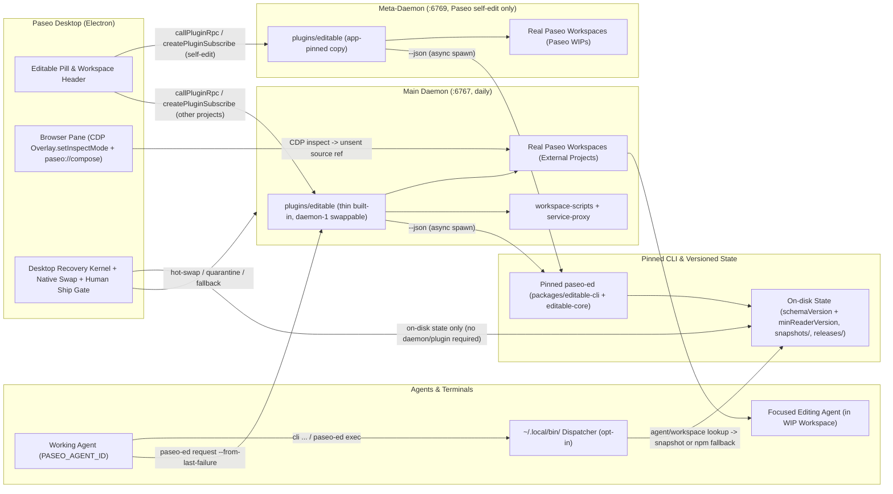

# Unified Editable Platform — Parked Multi-Project Blueprint (v2.1, M0-Verified)

> [!NOTE]
> **Status: Parked for future greenfield self-editable tools (and Babli if revisited).**
> M0 (empirical benchmarks + built-in plugin RPC spike) and M1 (monorepo merge + versioned recovery contract + bundled `paseo-ed`) were implemented and verified. Multi-project/Babli execution (M3–M4 below) was intentionally postponed so Paseo itself can finish cleanly first, and so any future multi-app self-editing can start from simple greenfield tools rather than retrofitting complex external deploy pipelines.
>
> See [M0 Benchmarks & Plugin RPC Report](./m0-benchmarks-report.md) for the empirical measurements referenced below, and [Editable Paseo](../editable-paseo.md) for the live Paseo-only documentation.

---

## 1. Core Thesis & Locked Principles

**Paseo _is_ the universal Editable engine for any project — for both humans and AI agents.** Editing Paseo itself is Project #1 using the isolated **Meta-Daemon** (`:6769`) and signed hot-swap delivery. All other projects (`babli` CLI, `babli` Web, or future greenfield tools) run through the **Main Daemon** (`:6767`).

### Locked Decisions & Invariants

1. **Thin Built-in Plugin + Fat Pinned CLI + Desktop Recovery Kernel (Zero Core Protocol Hotspots):**
   - `packages/editable-core` and `packages/editable-cli` (`paseo-ed`) live in the Paseo monorepo as normal fork-owned workspace packages holding all heavy logic (crypto, archives, git, snapshots, impact, ship).
   - `plugins/editable` is a **thin server-only built-in plugin** (1 line in `builtinPlugins`, complying with `docs/plugins.md` by importing only `@getpaseo/plugin/*`, `zod`, and Node built-ins) that registers plugin RPCs/subscriptions, `agent.open.before` (injecting per-agent Editable tools/env without global MCP schema bloat), and workspace metadata — delegating execution asynchronously to a **pinned `paseo-ed --json`**.
   - **Zero edits** to the fork's top 4 upstream conflict hotspots (`messages.ts`, `websocket-server.ts`, `session.ts`, `daemon-client.ts`).
   - Built-ins travel inside the signed `daemon-1` tarball, so Main Daemon receives engine updates via existing signed hot-swap + quarantine, while Meta-Daemon keeps its **app-pinned packaged copy** (never self-reloaded on Meta).
   - **Desktop Recovery Kernel:** Electron Desktop + a `paseo-ed` bundled inside app Resources own native renderer/daemon swap, recovery, and the human **Ship** gesture. Recovery operates purely on versioned on-disk state (`schemaVersion` + `minReaderVersion`; unknown newer versions boot bundled recovery), working even when both daemons and all plugins are dead.
2. **Editable WIPs = Real Paseo Workspaces (Separate Release/Device Lifetimes):**
   - Every local Editable WIP is a standard Paseo workspace carrying `metadata.editable` (owned exclusively by Meta-Daemon for Paseo, and Main Daemon for external projects), retiring `branches/<slug>.json`.
   - Links and targets always carry `(serverId, workspaceId)`. If Meta-Daemon is offline, Paseo WIPs show as unavailable with a restart action — **never** falling back to Main.
   - Immutable releases, signed channels, remote WIP index pointers, and device quarantine/rollback records remain independent of workspace lifecycle (surviving WIP deletion/archive).
3. **Agent Autonomy vs. Human Ship Authority:**
   - Agents can freely create WIP features, stage builds, inspect apps, and switch between WIP trials in their own session (`paseo-ed use` / `unuse` / `exec`).
   - **Ship** (landing to base ref / opening PR / promoting live release) is strictly a **human UI action** in Desktop bound to the exact `(project, targetRef, commitSha, artifactDigest)`. Delegation depth and Ship authority are enforced by the daemon/Desktop from session records (`parentAgentId`), never via spoofable env vars.
4. **Coexistence With npm-Installed CLIs & Control-Plane Safety:**
   - Global npm-installed CLIs (under `nvm`) are never mutated.
   - Non-control-plane CLIs use an opt-in `~/.local/bin/<bin>` dispatcher (ahead of `nvm` on `PATH`), keying on `PASEO_AGENT_ID` → opt-in `PASEO_WORKSPACE_ID` → fallthrough to the next `<bin>` on `PATH`.
   - Control-plane CLIs (`paseo`, `paseo-ed`) are trialed **only** via explicit `paseo-ed exec <proj>@<slug|handle> -- ...` so a broken trial can never shadow `~/.local/bin/paseo` or break `unuse`/recovery.

---

## 2. Target Monorepo Layout

```text
infi-pc/paseo/
  packages/
    editable-core/          # Fork-owned: schemas, impact classifier, Ed25519 crypto, tar/archive, versioned state
    editable-cli/           # Fork-owned: `paseo-ed` CLI + native APFS clonefile.c helper (pinned outside trial overlays)
    ...                     # existing upstream packages (protocol, client, server, app, desktop, cli, plugin, ...)
  plugins/
    editable/               # Fork-owned thin server-only built-in plugin (1 line in builtinPlugins; calls pinned `paseo-ed --json`)
                            # Exports shared Zod RPC contracts outward via `plugins/editable/shared/contracts.ts`
    worktree-include/       # existing upstream plugin
  infra/
    cloud-shelf/            # Standalone Cloudflare Worker + R2 (excluded from root npm workspaces)
```

### Explicitly Cut From v1 (Simplifications From Architecture Review & M0)

- **Cut `packages/editable-web` third-party extraction & external `<EditableBridge />`:** Replaced by **Paseo Browser Pane + Electron CDP (`Overlay.setInspectMode`) + existing `paseo://compose` + existing browser MCP tools**.
- **Cut universal `WorktreeManagerRegistration` warm-worktree pool & pnpm CoW dependency cache:** M0 proved pnpm `--filter ... --offline --frozen-lockfile` takes **1.49 s** (and full offline install takes **10.39 s** vs **8.00 s** for CoW + reconcile). Only Paseo (`npm`, **7.81 s** CoW vs ~60 s+ `npm ci`) needs APFS `clonefile-darwin` dependency hydration.
- **Cut directory-source plugin reload in production:** Failed `paseo plugin reload` leaves the plugin unloaded with no restore and defeats Meta-Daemon pinning. Keep directory-source install strictly for `Paseo Dev.app` development.

---

## 3. System Architecture



---

## 4. Key Mechanisms (Verified in M0)

### A. Single Project-Level Ship Owner & Per-Project Landing Policy

Surfaces own only `classify`, `verify`, `build`, `trial`, and `postLandDeliver`. **One project-level Ship** owns landing, push/PR, cleanup, and then runs `postLandDeliver` across all impacted surfaces.

**Verify-before-land invariant:** Only advance a base ref to a commit already verified in the WIP worktree. If base moved, merge base into the WIP, mark the trial handle stale (`sourceChangedSinceVerification: true`), re-verify, then fast-forward. Record local land, remote push/PR, and pointer updates separately so partial failures converge cleanly on retry.

| Project                         | Base ref                                                                     | Landing strategy                                                                                                                                    | Cleanup & release                                                                   |
| ------------------------------- | ---------------------------------------------------------------------------- | --------------------------------------------------------------------------------------------------------------------------------------------------- | ----------------------------------------------------------------------------------- |
| **Paseo**                       | `paseo-customizations` (detached clone; `main` is read-only upstream mirror) | Compare-and-swap ref + detach clone + push `sha:refs/heads/paseo-customizations`                                                                    | Archive WIP workspace; promote signed `prod` channel (`electron-web` / `daemon-1`)  |
| **PR-based repos (e.g. Babli)** | Configured base branch (e.g. `develop`)                                      | Push WIP branch + open PR against base (never mutates user checkout)                                                                                | Preserves WIP until merge/discard; optional local `~/.local/bin/<bin>` shim promote |
| **Local FF repos**              | Configured `baseBranch`                                                      | If base is checked out & clean, `merge --ff-only` inside that worktree; if dirty, refuse or push-only — **never `update-ref` a checked-out branch** | Archive WIP workspace                                                               |

### B. CLI Trials, Whole-Worktree APFS Snapshots & Failed-Invocation Replay

1. **Whole-Worktree Snapshot (M0-Proven Hermeticity):**
   - At `stage`, `paseo-ed` CoW-clones the verified worktree (minus `.git`) into `~/.paseo/editable/snapshots/<project>/<commit>/` (**0.22 s** for filtered pnpm CLI worktree; **4.58 s** for full worktree) and invokes `node <snapshot>/<binEntry>` directly (preserving the **caller's `cwd`**).
   - M0 verified **0 symlink escapes** across all 29 symlinks in `apps/cli/node_modules` and confirmed execution succeeds from a foreign `cwd` in **158 ms** even after `git worktree remove --force` deletes the source WIP.
   - Because `.bin/tsx` inside a snapshot retains `NODE_PATH` pointing to the deleted WIP, **live `tsx` runs only against an active leased WIP**, while **immutable staged snapshots run `node <snapshot>/<binEntry>` directly**.
2. **Durable Trial Handle:**
   - Identifies `{ id, hostServerId, projectId, producingWorkspaceId, consumingAgentId?, commitSha, snapshotPath, digest, verifyResult, sourceChangedSinceVerification, createdAt }`.
   - Survives WIP workspace archival via leases; lets Agent A keep running Snapshot A while its worker stages Snapshot B.
3. **Failed-Invocation Capture & Repro Replay:**
   - When the dispatcher runs under an agent (`PASEO_AGENT_ID` set), it records `{ bin, digest, argv, cwd, exitCode, redactedStderrTail }` to a bounded per-agent ring (never polluting `stdout` for JSON consumers).
   - Agent A calls `paseo-ed request <project> --from-last-failure` → Paseo spawns a WIP workspace with the exact failure attached as prompt + acceptance contract.
   - Before staging, the worker replays a designated **read-only** repro against the staged snapshot and attaches before/after evidence directly to the trial handle for human Ship review.
4. **Dispatcher Keying Order:**
   1. Explicit `paseo-ed exec <proj>@<slug|handle> -- <args...>` (always reliable across any provider/shell; mandatory for control-plane `paseo` and `paseo-ed`).
   2. Active `PASEO_AGENT_ID` selection (per-agent isolation inside shared workspaces).
   3. Opt-in `PASEO_WORKSPACE_ID` selection (for interactive terminals).
   4. Fallthrough to the next `<bin>` on `PATH`, skipping the dispatcher itself and preserving exit codes/signals.

### C. Web Editing via Paseo Browser Pane CDP Picker (Zero External SDK)

- Reuse Paseo Desktop's existing guest debugger (`packages/desktop/src/features/browser-automation/service.ts`, `ipc.ts`), browser MCP tools, and `paseo://compose`.
- Add `Overlay.setInspectMode` → resolve clicked element's source attribute (e.g. `data-locatorjs` or similar) → validate/normalize path inside the selected WIP → append an **unsent** source reference to that WIP's Paseo composer.
- Keep branch switching, agent chat, and Ship inside Paseo (no third-party browser WebSocket exposure).

### D. Verified Built-in Plugin RPC & Subscription Pattern (M0 Spike)

- Verified end-to-end against two isolated test daemons (Main + Meta) with `pluginsEnabled: false`: a server-only built-in plugin (`plugins/editable`, no `index.client.tsx`) stays active, stays hidden from `listPlugins()`, appears in `getPluginCatalog()`, accesses `context.paseo`, and answers typed RPCs/subscriptions directly from fork app code via `callPluginRpc` / `subscribePluginRpc` + `createPluginSubscribe` + `getHostRuntimeStore().getClient(serverId)` with **zero core protocol edits**.
- **Two runtime invariants locked by M0:**
  1. **Async jobs for >30s operations:** `PluginRuntime` enforces `REQUEST_TIMEOUT_MS = 30_000` on every unary `invokePluginRpc`. `stage`, `verify`, `build`, and `check` must start via a fast unary `job.start` RPC and stream progress over `job.watch` (`observePluginRpc`).
  2. **Async-only CLI delegation & outward contract export:** Because built-ins run in-process (`InternalPluginChild`), `plugins/editable` must spawn `paseo-ed --json` asynchronously (never `*Sync`). Keep Zod RPC contracts in `plugins/editable/shared/contracts.ts` and export them outward via `@getpaseo/builtin-plugins`.

---

## 5. Original Multi-Project Milestones (Reference Only)

| Milestone                                                     | Scope                                                                                                                                                                                                           | Status                                             |
| ------------------------------------------------------------- | --------------------------------------------------------------------------------------------------------------------------------------------------------------------------------------------------------------- | -------------------------------------------------- |
| **M0: Measure & Spike**                                       | Benchmarked pnpm/npm worktree & snapshot timings and verified server-only built-in plugin RPC + subscriptions across dual daemons.                                                                              | **Done** ([report](./m0-benchmarks-report.md))     |
| **M1: Monorepo Merge + Installed Recovery Gate**              | Merged `editable-core`, `editable-cli`, and standalone `infra/cloud-shelf` into `infi-pc/paseo`, deduplicated Desktop, bundled `paseo-ed`, added versioned recovery contract, passed all 3 clean-install gates. | **Done**                                           |
| **M2: Paseo-on-Paseo via Thin Plugin + Real Meta Workspaces** | Server-only `plugins/editable`, Meta-Daemon workspaces, `paseo.json` CoW marker, resumable verify-before-land Ship.                                                                                             | **Active (Paseo Long-Term Plan Phase 2)**          |
| **M3: External CLI + Agent Self-Edit Loop**                   | Whole-worktree APFS snapshots, `paseo-ed exec`/`use`/`unuse`/`request --from-last-failure`, `PASEO_AGENT_ID`-keyed dispatcher, repro replay, PR-mode Ship.                                                      | **Parked** (revisit for greenfield tools or Babli) |
| **M4: External Web via Browser Pane CDP Picker**              | `Overlay.setInspectMode` on Electron guest debugger → `paseo://compose` + lazy DB/preview lifecycle.                                                                                                            | **Parked** (revisit for greenfield tools or Babli) |
